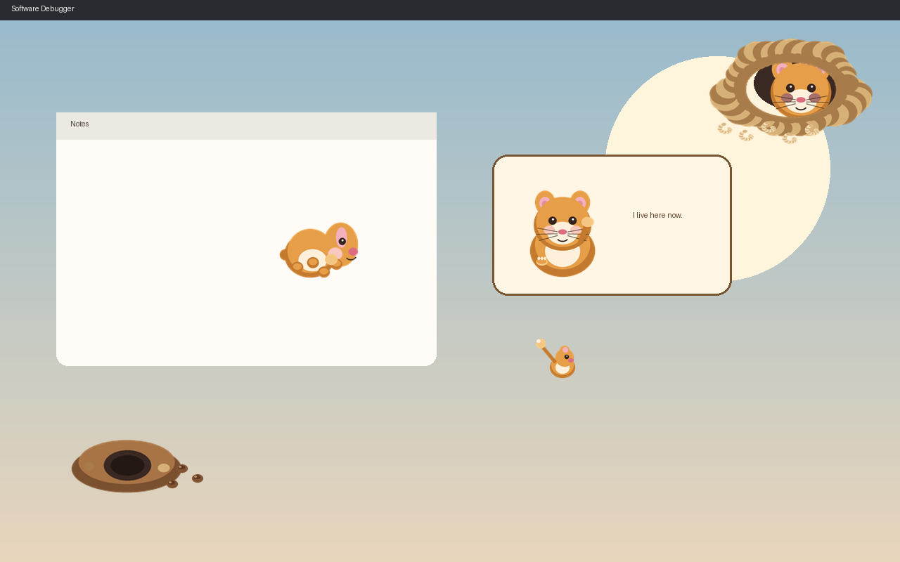
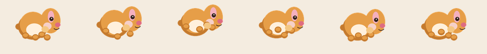

# Hamster Infestation

Hamster Infestation is a joke you install on purpose. It draws cartoon hamsters on the Mac desktop. It does not damage files, it does not use the network, and it does not collect anything. Restart, shutdown, and logout always go through.

The project keeps the hamster name. The app you actually install does not. In Finder it is called **Software Debugger**. The file is `Software-Debugger-4.2-hmst.app`. The `hmst` is the hint. The icon is a plain magnifying glass, so the download looks ordinary before you open it. Once it is running, the hamsters are obvious.



## What you need

- A Mac running macOS 12 Monterey or anything newer
- Xcode, which is free from the App Store (it is a large download)

You do not need an Apple developer account. The app is not notarized. The first time you open it, you right-click it and choose Open.

## 1. Install Xcode

1. Open the **App Store**.
2. Search for **Xcode**.
3. Click **Get** or **Install**. This can take a while.
4. Open **Xcode** once. If it asks you to agree to the license, click **Agree**. You can quit Xcode after that. You do not need to make a project.

## 2. Build and install

Open **Terminal**. Press Command-Space, type `Terminal`, and press Return.

Go into the project folder. If you cloned it:

```bash
git clone THE_REPOSITORY_ADDRESS
cd THE_FOLDER_NAME
```

Use the address from the page where you got this project. If you already have the folder, just `cd` into it.

Run these commands one at a time. The first build can take a minute or two.

```bash
sudo xcode-select -s /Applications/Xcode.app/Contents/Developer
chmod +x scripts/build-app.sh
./scripts/build-app.sh
cp -R dist/Software-Debugger-4.2-hmst.app /Applications/
```

`sudo` asks for your Mac password. Nothing appears while you type it. Press Return when you are done.

The script puts the app here:

- `dist/Software-Debugger-4.2-hmst.app`
- `dist/Software-Debugger-4.2-hmst.zip`, if you want to move it
- `dist/Software-Debugger-4.2-hmst.dmg`, a disk image with the same app

Build it on the Mac you will use it on. In Finder the name on the icon is **Software Debugger**, not the long file name.

## 3. Open it the first time

macOS blocks a new app that is not from the App Store until you approve it.

1. Open **Finder** and go to **Applications**.
2. **Right-click** Software Debugger (or Control-click it).
3. Choose **Open**.
4. In the dialog, click **Open**.

You only do the right-click once. After that, a normal double-click is fine.

If macOS says the app is damaged or that it cannot check it for malicious software, quit any copy that is running and run:

```bash
xattr -dr com.apple.quarantine /Applications/Software-Debugger-4.2-hmst.app
```

Then right-click Software Debugger and choose **Open** again.

There is no Dock icon. A hamster peeks out of a chewed hole in the top corner of the desktop, under the menu bar. That is how you know it is running.

## 4. Allow Accessibility, if you want the full joke

A window explains this the first time. Accessibility lets the app notice when you type `-hamster`, and lets the hamster follow the pointer.

It remembers only the last 8 characters, which is just long enough to see that phrase. It does not save what you type, and it does not send anything anywhere. The letters still appear in whatever you were typing.

You can say **Not now**. The hamsters still show up. You can still remove the app without Accessibility.

If you say yes:

1. Click **Ask macOS**.
2. In **System Settings → Privacy & Security → Accessibility**, turn **Software Debugger** on.
3. If the switch will not stay on, quit the app (see below) and open it again with a right-click → **Open**.

The system window says Software Debugger, because that is the name of the app.

## What you will see

- The pointer becomes a small hamster, once Accessibility is on and you move the mouse. Until then, the normal pointer stays. On the app's own windows the pointer can be the hamster either way.
- Every so often a hamster runs across the screen. Those windows ignore the mouse, so they never take a click.
- A small sign pops up and fades away.
- Burrows show up on the desktop, with a few tiny cartoon pellets. They are meant to be silly, not gross.
- Wood shavings pile up under the corner hole.
- The corner hamster and the burrows sit on the desktop, underneath normal windows. Runners and signs float above other apps but do not block them.

Double-click the corner hamster to open the settings window. The title says Software Debugger.

The slider is **Chill**, **Normal**, or **Chaos**. Chill is a hamster every few minutes. Chaos is busier. There is also **Pause hamsters for 1 hour**, and a switch for the hamster pointer.

**Start when I log in** is off until you turn it on. On macOS 13 and later it uses the system login item. On macOS 12 it uses a small login file in your home folder. Uninstall removes it.

## Remove it

Any one of these asks "Are you sure you want to delete?" **Yes** turns off the login item, deletes the settings, moves the app to the Trash, and quits. **No** leaves everything as it is. None of these three need you to find a Dock icon.

### 1. Type `-hamster`

Type those eight characters in a row, with the dash, in lowercase: `-hamster`

This works in other apps only if Accessibility is on. It always works while the settings window is in front. The word may be left behind in the document you were typing. Delete it like any other typo.

### 2. Run `minus-hamster` in Terminal

This does not need Accessibility.

From the project folder, before or after you install the command:

```bash
chmod +x scripts/minus-hamster
./scripts/minus-hamster
```

Or install the command from the settings window (**Install the minus-hamster command**), then:

```bash
minus-hamster
```

If Terminal says the command was not found, run this once, quit Terminal, and open it again:

```bash
echo 'export PATH="$HOME/.local/bin:$PATH"' >> ~/.zshrc
```

### 3. Option-click the corner hamster

Hold the Option key and click the hamster peeking out of the hole. This does not need Accessibility. You do need to be able to see the desktop corner. If a window is covering it, move that window.

## If you only want the hamsters to stop for now

Double-click the corner hamster and click **Quit for now**. The app quits. If **Start when I log in** is on, it comes back at the next login. **Pause hamsters for 1 hour** leaves it running but quiet, and puts the normal pointer back.

## If the pointer disappears

The real pointer is hidden only while a hamster is being drawn in its place, and only after the app has seen the mouse move. Quitting puts it back.

If it ever stays hidden:

1. Open **Activity Monitor** (Command-Space, type Activity Monitor).
2. Search for `Software-Debugger-4.2-hmst`.
3. Select it and click the **X** to force quit.

The pointer belongs to that app. When the app is gone, the pointer comes back. You can also log out. Nothing else is stuck: clicks still land, and the runners do not block them.

## What it will not do

- It will not stop a restart, shutdown, or logout. If one of those starts, a sad hamster says "Don't do it!" for about two seconds, and then the Mac continues.
- It will not use the network.
- It will not read your documents, mail, or photos.
- It will not keep a record of your typing.
- It will not hide from Activity Monitor. The process name is `Software-Debugger-4.2-hmst`.

## Optional check of the built-in tests

You can skip this. It does not start the app.

From the project folder:

```bash
swift test
```

That checks the visit timer, the `-hamster` detector, and the list of files uninstall is allowed to touch. It does not open windows.

## The pictures

The hamsters are drawn for this project. They are not taken from a film or a game. The installed app stores them under plain file names. The icon is only a magnifying glass.



